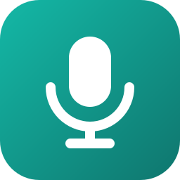
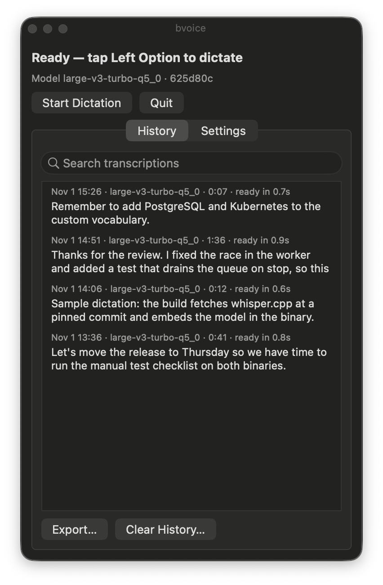

<p align="center">
  
</p>

<h1 align="center">bvoice</h1>

<p align="center">
  <b>Local dictation for macOS; tap a key, talk, tap again, and Whisper puts the text on your clipboard.</b>
</p>

<p align="center">
  One sentence or several pages, the text is ready about a second after you stop.<br>
  Everything runs on your Mac, and each binary has its Whisper model built in.<br>
  <i>By Brian Nunez.</i>
</p>

<p align="center">
  
  
  
  
  <br>
  
  
  
</p>

<p align="center">
  <a href="#quick-start"></a>
</p>

<p align="center">
  <a href="#quick-start"><b>Quick start</b></a> ·
  <a href="docs/configuration.md">Configuration</a> ·
  <a href="docs/architecture.md">Architecture</a> ·
  <a href="docs/roadmap.md">Roadmap</a>
</p>

<br>

<p align="center">
  
  <br><sub><b>Floating window</b>: status, searchable history and settings, shown here with sample entries.</sub>
</p>

> [!NOTE]
> **There is no published release yet.** Build the binaries from source with the [quick start](#quick-start); it needs the Xcode Command Line Tools and Go.

<p align="center">
  <a href="#why-bvoice">Why bvoice</a> ·
  <a href="#quick-start">Quick start</a> ·
  <a href="#how-it-works">How it works</a> ·
  <a href="#models">Models</a> ·
  <a href="#settings">Settings</a> ·
  <a href="#development">Development</a> ·
  <a href="#license">License</a>
</p>

## Why bvoice

- **Self-contained.** One executable holds the Whisper model, whisper.cpp, its Metal shaders, SQLite and miniaudio. Nothing needs to sit beside it.
- **No permissions.** bvoice needs no Accessibility or Input Monitoring permission. The only prompt is the microphone consent.
- **Fully local.** Nothing touches the network at runtime. The only network use is at build time, to fetch whisper.cpp, Go modules and models.
- **Quick.** Audio is transcribed in the background at each pause, so only the last few seconds remain when you stop.
- **Out of your way.** The floating window never takes focus from the app you're typing in, and the hotkey ignores shortcuts like ⌥← and ⌥e.

## Quick start

Install the Xcode Command Line Tools (`make`, `clang`) and Go 1.24 or later, then build and run:

```sh
git clone https://github.com/brian-nunez/bvoice.git
cd bvoice
make build                     # build dist/bvoice-small.en-q5_1
./dist/bvoice-small.en-q5_1    # start bvoice
```

The first build fetches whisper.cpp at a pinned commit and compiles it (Metal shaders embedded), resolves Go modules, and downloads the model into `build/models/`.

Tap **Left Option** to start listening, talk, and tap it again. The transcript goes to the clipboard, ready for ⌘V.

Flags apply to that run only, and the window offers **Sync** to save them:

```sh
./dist/bvoice-large-v3-turbo-q5_0 --sounds=false --auto-stop=10
./dist/bvoice-small.en-q5_1 --help      # all options
```

## How it works

**Dictation.** A tap counts only when the key goes down and back up within 400 ms, with no other modifier held and no key or mouse press in between. While you talk, bvoice splits the audio at pauses and transcribes each chunk in the background, in order. On stop, it transcribes the last partial chunk, cleans up the text, copies it to the clipboard and saves it to history.

**Menu bar and window.** A menu bar icon opens a small floating window with status, searchable history (click an entry to copy it), export, settings, and a notice when launch flags differ from your saved settings. bvoice has no Dock icon.

**Storage.** Settings and history are stored in `bvoice.db` in the user configuration folder (`~/Library/Application Support/bvoice` on macOS).

**Platforms.** macOS is supported. The core is platform-independent; each platform supplies its own hotkey, clipboard, sounds and UI (see [Adding a platform](docs/architecture.md#adding-a-platform)).

## Models

Each binary embeds one Whisper model, and `make all` builds the default set:

| Model | Binary | Size | Notes |
|---|---|---|---|
| **`small.en-q5_1`** | `dist/bvoice-small.en-q5_1` | ~195 MB | Fast, accurate for most dictation |
| `large-v3-turbo-q5_0` | `dist/bvoice-large-v3-turbo-q5_0` | ~564 MB | Most accurate |

Build with any other whisper.cpp model using `make build MODEL=base.en-q5_1`. To switch models, quit one binary and start another. History is shared between them.

## Settings

Every setting can be changed in the window or passed as a flag.

| Setting | Default | Flag |
|---|---|---|
| Sounds | on | `--sounds` |
| Sound volume | 0.5 | `--sound-volume` |
| Hotkey | Left Option | `--hotkey` |
| Show window on launch | on | `--window` |
| Window always on top | on | `--on-top` |
| Copy to clipboard automatically | on | `--auto-copy` |
| Add trailing space | on | `--trailing-space` |
| Custom vocabulary | empty | `--vocab` |
| Microphone | system default | `--mic` |
| Auto-stop after silence | off | `--auto-stop` |
| Max recording length | 30 min | `--max-minutes` |
| History entries to keep | 500 | `--history-limit` |

Command-line only: `--data-dir`, `--verbose`, `--version`, `--help`. The [configuration reference](docs/configuration.md) covers allowed values, behavior and examples for each.

## Documentation

- [Configuration](docs/configuration.md): every setting and flag
- [Architecture](docs/architecture.md): design, pipeline, code layout and data schema
- [Roadmap](docs/roadmap.md): planned work

## Development

Development also needs golangci-lint v2 for `make lint` and `make fmt`, and `gh` for releases.

```sh
make all                          # dist/bvoice-small.en-q5_1 and dist/bvoice-large-v3-turbo-q5_0
make build MODEL=base.en-q5_1     # a binary with any other whisper.cpp model
make model && make test           # tests, including a real transcription with the downloaded model
make lint                         # linters and format checks (.golangci.yml)
make fmt                          # apply gofumpt and goimports
make release TAG=v0.1.0           # build all, tag, push the tag and create a GitHub release
make clean                        # remove build outputs
```

### Layout

```text
cmd/bvoice           entry point and flags
internal/app         controller (state machine), platform-independent and tested with fakes
internal/vad         pause detection that drives background transcription
internal/whisper     whisper.cpp via cgo; model loaded from memory
internal/settings    option table: defaults, flags, validation, sync diff, UI controls
internal/store       SQLite settings and history
internal/platform    hotkey, clipboard and sounds (macOS in platform_darwin.go)
internal/ui          UI contract; ui/appkit is the macOS implementation
docs                 configuration reference, architecture and roadmap
```

## Manual test checklist

These need a real Mac:

1. **Permissions:** the only prompt is the microphone one, on the first dictation. Tapping the hotkey works without Accessibility or Input Monitoring.
2. **Tap detection:** ⌥-shortcuts (⌥←, ⌥-click, typing ⌥e) don't start dictation; a quick tap does.
3. **Short and long dictation:** text is ready about a second after stopping. `--verbose` logs per-chunk timing and the latency after stop.
4. **Clipboard and sounds:** ⌘V pastes the text with a trailing space; sound and volume settings apply.
5. **Window:** the menu bar icon shows and hides it, `Esc` and the close button hide it, right-click opens the menu, "always on top" toggles, and it never takes focus from the app you're typing in.
6. **History:** search, click to copy, **Export…** writes Markdown, **Clear History…** asks first.
7. **Flags:** starting with a value that differs from the saved one shows the sync notice; **Sync** saves it and hides the notice.
8. **Models:** both default binaries build and run; History shows each one's "ready in" time.

## License

bvoice is licensed under the [MIT License](LICENSE). Copyright (c) 2026 Brian Nunez.
